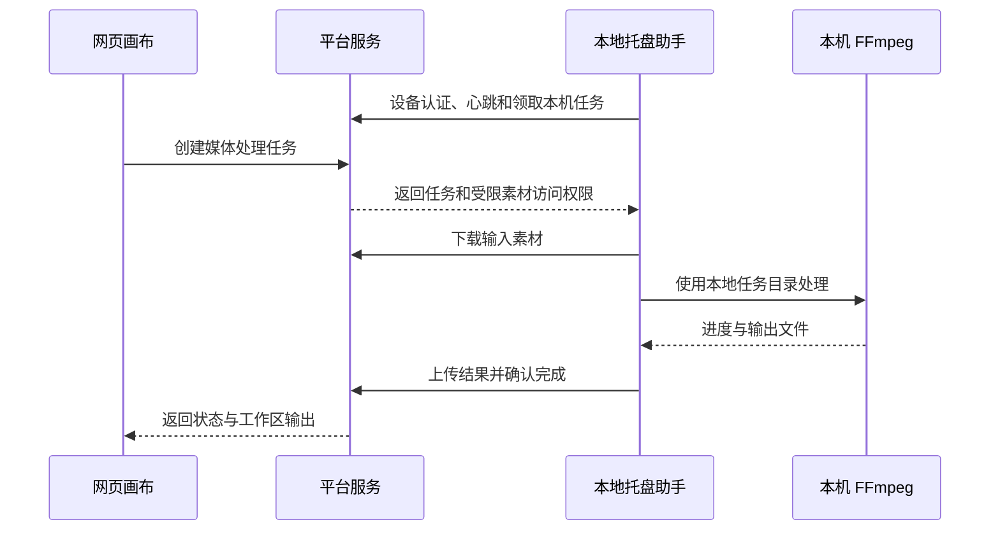

# UnionFlfow 本地媒体助手设计

本文保留最初的完整设计，不能作为所有能力均已实现的说明。2026-11-03 已在本地代码接入 Windows 助手 0.5.0 的 FFmpeg 执行、受限素材传输及结果回填，当前实现与边界见 `localHelperWindows.md`。下文的跨重启恢复、租约续期和断点上传等仍属设计；发布和真实配对设备验收须单独确认。

## 使用方式

1. 用户安装“UnionFlfow 本地助手”，安装包同时携带固定版本的 `ffmpeg.exe` 和 `ffprobe.exe`、校验信息及对应许可证。使用应用私有目录，无须另装开发环境或修改系统 PATH。
2. 助手首次启动显示设备授权码，用户在平台网页确认绑定自己的账户。助手取得仅用于本地媒体任务的设备凭据。
3. 助手驻留系统托盘，网页显示“本地助手已连接”。用户触发媒体处理时，任务交给选定的本机助手。
4. 助手下载所需素材，在本机运行 FFmpeg，再上传结果。服务端确认文件保存后，画布更新输出。
5. 关闭网页后助手继续执行；刷新网页从服务端读取原任务状态。托盘菜单提供打开画布、任务列表、暂停接收任务、退出；开机启动由用户选择。

助手未连接时，网页提示启动助手；不静默改用服务器转码。同账户绑定多台设备时显式选择处理设备，不把本机任务分发给其他用户或任意空闲设备。

## 调用链路

首版由助手通过 HTTPS 长轮询领取任务，进度通过 HTTPS 回传，复用现有域名和服务。任务领取须在数据库中原子完成。暂不增加浏览器到本机的 HTTP 接口，也不要求开放本机防火墙端口，避免依赖跨域及浏览器本地网络权限。后续有必要再增加 WebSocket 通知。

## 本地执行范围

- 网页显式触发的视频裁剪、音轨提取、音视频分离、字幕烧录、拼接、格式转换，以及对应媒体信息读取，逐项接入本地任务。
- 模型生图、生视频和计费请求继续走原平台流程；“本地恢复任务”不能触发这些生成接口。
- 服务端自动缩略图和媒体访问鉴权保持现有实现；用户媒体处理的编码、滤镜负载转到本机。
- 原素材在服务器时必须先下载；结果继续保存在服务器时必须上传。本方案转移计算负载，仍有网络流量和本地缓存开销。

## 任务状态与资源控制

任务状态为 `awaitingDevice → queued → downloading → processing → uploading → completed`，另有 `interrupted`、`failed`、`cancelled`。按阶段显示进度，上传和服务端确认完成前不显示任务完成。

- 每台助手默认同时处理一个重任务；FFmpeg 解码、编码和滤镜线程按本机资源统一限制，不仅设置某一个输出参数。
- 下载、上传设置独立的小并发上限，媒体信息读取使用短任务限额，避免占满网络、磁盘或进程数。
- 设置任务超时、队列长度与缓存容量上限；取消排队任务立即生效，取消运行任务须等子进程退出后才能释放执行名额、清理临时文件。
- 服务端用现有 PostgreSQL 保存任务归属、设备、输入版本、参数、状态和输出。本地用 `@toonflow/file` 的 `writeAtomic` 保存执行记录。
- 同一次用户操作使用固定任务编号和幂等键；刷新、重连和重复回报只能更新原任务，不创建第二份处理任务。
- 领取任务附带租约并定期续租。助手掉线后先进入待核对状态，不立即让另一设备重复执行；过期执行实例不能提交覆盖结果。
- 网页关闭不取消助手任务。助手退出或系统重启会中断本机处理；重启后先核对原记录，已完成本地处理的任务只重试上传。未完成的 FFmpeg 转码不承诺从中间帧续算，必要时重跑同一项本地处理。

## 文件传输和账户边界

- 设备凭据绑定账户和设备，可独立撤销；不向助手下发模型 API Key，不复用浏览器 Cookie，不通过 URL 传递长期凭据。
- 设备授权继续遵守平台现有账户及管理员访问限制；设备绑定不会扩大项目权限。
- 每次领取、下载、上传和确认结果都校验任务归属、设备、项目访问权和当前执行实例。现有网页预览链接依赖网页会话，不能直接作为助手的长期下载权限。
- 服务端下发网页工作区所需的文件清单和版本，不把服务器绝对路径当作本机路径使用。网页素材映射到独立任务目录；明确指定的本机路径按当前 Windows 用户权限直接读取，指定的本机输出保存在本机。
- 只接受明确支持的媒体操作及经过校验的参数；本地根据操作构建 FFmpeg 调用，不执行服务端或网页传来的任意 Shell 命令。
- 输入版本变化时停止并提示重新确认，避免悄悄处理另一份素材。输出上传采用暂存、大小与摘要校验、最终确认；完整保存前不修改画布输出，不覆盖原素材。
- 原任务输出目录和节点归属在创建时固定。切换项目、切换账户或在另一画布打开页面，不改变任务的结果目标。
- 缓存按账户与任务隔离；任务执行或待上传期间不清理它的文件。清理只针对助手自己的缓存目录。

## 复用现有代码的方式

- `packages/ffmpeg` 已有版本检测、下载摘要校验、工作区工厂和参数校验，优先按公开 exports 复用；安装包内置工具还需检查实际编码器、滤镜和平台兼容性。
- `packages/ffmpeg/src/browser.ts` 当前把调用发送到网站的 `/api/ffmpeg/execute`；`packages/nodeScaffold/src/nodeFfmpeg.ts` 是节点使用的入口。迁移须保持进度、取消、错误和返回值语义，不能只替换请求地址。
- 网页节点的本地任务适配放在所属业务模块；跨插件共享逻辑放在 `@toonflow/node-shared`，不把设备任务、上传和本地业务调度混入节点脚手架或 `@toonflow/file`。
- `apps/desktop/src/connection.ts` 的远程模式默认把 FFmpeg 请求代理给服务端；已有桌面程序不等于已经支持本地卸载执行。
- 新助手使用独立的 `apps/localHelper`，主逻辑使用 TypeScript/Bun，不启动完整画布服务或模型运行环境。Windows 托盘外壳可沿用仓库现有原生辅助程序的打包方式。
- 当前安装的 `electrobun` npm 包是运行时工具链引导包，不包含可直接确认的托盘 SDK。若采用现有桌面 SDK，需先核实实际工具链兼容性，不能把它视为已经验证可直接复用。
- 服务端任务与传输接口沿用 Express、现有 PostgreSQL 和鉴权入口；新增路由按仓库规范生成注册文件。首版不需要 Redis 或新的服务框架。

## 实施顺序与验收

1. 先完成 Windows 托盘程序、内置 FFmpeg/ffprobe、设备绑定和在线状态。
2. 用一项视频裁剪打通“创建任务、下载、本机执行、上传、画布回填”，同时保留原有取消语义。
3. 按同一任务协议接入其余已存在的媒体操作，不保留未经声明的任意远程执行入口。
4. 用真实操作验收：关闭网页继续处理、刷新恢复进度、断网后重连、重复领取与回报、取消后释放进程、切换账户隔离、输入变化、磁盘不足及上传失败。按仓库规范执行已有类型检查、构建和手动验证，不新增测试模块。

发布前需要在真实 Windows 环境确认安装、托盘生命周期、编码器和字幕字体支持。当前设计不代表安装包或本机处理链路已经完成。
