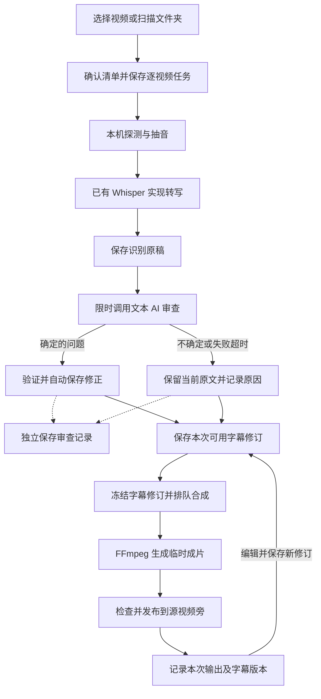

# 托盘批量字幕功能调研与方案

调研及修订日期：2026-11-06。本文依据当前工作区源码（包含未提交改动）、2ByteASR v0.9.4 公开源码及用户后续明确要求整理，不代表线上服务或已安装托盘的运行状态。用户所说的“wishaee”按项目已有 Whisper 逻辑理解。

## 1. 可行性结论

可行，适合接入现有 Windows 托盘的 Vue 控制中心。实现“本地字幕任务”：每个视频有一条持久化记录，批次只负责组织这些记录；Whisper 生成、AI 校对、字幕编辑、视频合成分别保存结果。

已确定的规则：

- **AI 明确发现的问题直接修正；不确定的保留原文并记录。审查结论、失败或超时均不要求人工确认，不中断后续合成。**
- **网页 AI 聊天和托盘本机聊天都可以直接发起视频识别任务。** 任务提交成功后独立于聊天连接执行。
- **画布字幕节点和字幕烧录节点保留，云端网页照常使用。** 节点 UI、连线、字幕编辑、保存和输出继续由画布承载，只把识别与编码交给托盘。
- **所有 Whisper 环境检测、安装、权重下载和识别执行都在本地托盘。** 云端移除 Python／torch 执行和本机环境配置，保留节点及任务协调接口，不提供服务端识别回退。
- **分阶段交付：先完成并验证本地批量任务，本阶段保留云端现有识别链路；确认本地可用后再迁移云端。** 下文云端迁移是后续目标，不在本轮同时切换。
- **站点不保存运行环境或权重镜像，全部从对应官方来源下载。** 先检测本机 CPU、可用内存、GPU／CUDA 和目标磁盘空间，再推荐模型。

执行链路：本机扫描／选择视频或聊天发起 → 本机 FFmpeg 抽音 → 本机 Whisper → 文本 AI 自动修正并保存审查记录 → 保存 SRT → 本机 FFmpeg 烧录 → 将 SRT 和字幕版视频保存到源视频旁边。

上述自动出片是本机批量视频任务的流程。画布字幕节点继续负责生成／编辑 SRT，识别完成后返回节点草稿，显式保存再更新 STRING 输出；生成视频由画布字幕烧录节点负责，不把两个节点强行合并。

这是中等规模改造，主要工作集中在 Whisper 执行部分复用、持久化任务、原生文件选择与预览、字幕版本管理。已有节点不能直接放进托盘运行，原因是它们依赖网页工作区、节点宿主或服务端配置。

首期完整覆盖批量导入、聊天发起、本机一键准备 Whisper 环境、自动识别与修正、逐视频任务、独立编辑、重新合成。暂不引入多模型投票、翻译、说话人分轨、逐字对齐、视频剪辑或复杂字幕动效。

## 2. 当前代码已经提供什么

| 能力 | 已核对的源码 | 可复用部分与边界 |
| --- | --- | --- |
| Windows 托盘与本地控制中心 | `apps/localHelper/native/tray.cs`、`apps/localHelper/ui/controlCenter.vue` | WinForms 托盘、WebView2、Vue、受限原生消息桥；目前只有 UI 文件夹映射，需要补原生多选文件、选目录及受控媒体预览。 |
| 本机 FFmpeg | `apps/localHelper/src/media.ts`、`packages/ffmpeg/src/runtime.ts` | 工具状态、安装、`createFfmpeg`、取消能力；媒体处理已有本机执行链路。本功能直接读本机素材，不经过网页工作区素材传输。 |
| Whisper | `apps/server/src/utils/whisper/runtime.ts` | 已有 Python／Whisper／torch／CUDA 检测、16 kHz 单声道 PCM 输入、模型缓存、转写及取消。当前 Python 子进程仍在服务端，执行逻辑需要迁至托盘，云端改为协调本机任务。 |
| 模型选择 | `apps/server/src/utils/whisper/types.ts` | `tiny`、`base`、`small`、`medium`、`large`、`turbo`；当前默认模型来自字幕节点配置。复用同一套识别实现，模型速度与准确率需要本机测量。 |
| SRT 读写 | `packages/nodeShared/src/subtitleSrt.ts` | 复用 `parseSrt`、`serializeSrt` 和时间格式化。现有解析校验不覆盖所有重叠、超出片长、阅读速度问题，需要在字幕业务中补规则。 |
| 字幕编辑与烧录 | `packages/nodes/subtitleNode/src/index.vue`、`packages/nodes/subtitleBurnNode/src/videoBurning.ts` | 已有草稿／保存区分、字幕解析、libass／libx264 检测、烧录进度及结果探测；当前烧录输入和目录管理绑定网页工作区，需抽出可复用执行部分。 |
| 账户文本模型与聊天工具 | `apps/server/src/utils/localHelper/chat.ts`、`tools.ts`、`apps/localHelper/src/protocol.ts` | 网页聊天和托盘聊天已有共用的 `localComputer` 工具协议；可增加字幕专用动作。已有设备鉴权、默认文本模型与平台请求，Key 留在服务端，字幕审查复用这些能力。 |
| 任务界面与日志 | `apps/localHelper/src/activity.ts`、`controlProtocol.ts`、`logger.ts` | 任务推送、取消、阶段展示及脱敏日志可以复用。当前任务只在内存中保留最近 100 项和未结束项，不能承担重启后的字幕任务历史。 |
| 本地持久化 | `apps/localHelper/src/conversations.ts`、`packages/file` | 复用按账户隔离、写入队列和 `writeAtomic` 的做法；字幕任务独立存储，不把字幕正文放进诊断日志或聊天历史。 |

特别需要保留三个边界：

- 当前 Whisper 只允许工作区内输入／输出，Python 子进程由服务器启动。迁移时把执行替换为托盘任务协调；工作区素材转交托盘和返回 SRT 时保留原有路径、账户及覆盖保护。保留现有 API 地址不代表服务器继续运行模型。
- 当前网页素材传输及通用文件批量操作有 20 个文件、单文件 100 MiB、整批 200 MiB 等限制。本机字幕处理不应先上传原视频，也不能通过 PowerShell 或自动拆批绕过这些限制。
- 托盘任务、传输与聊天已有暂停、退出、解绑和更新保护。字幕任务必须纳入这些生命周期，日志保留规则继续沿用。

## 3. 2ByteASR 的参考价值

已通过 GitHub Releases API 核对，调研时最新发布为 [v0.9.4](https://github.com/NOTBAD314/2ByteASR/releases/tag/v0.9.4)，对应源码提交 `7c44b93dac9c1ed5bfe49658ceaea09030d89f80`。README 的下载文字仍显示较早版本，因此版本判断以 Releases 为准。未下载安装器或运行其程序。

它确实实现了相关工作流：识别、AI 校对、字幕独立编辑、字幕文件导出，以及重新压制成片。它还支持多模型复听、时间对齐和复杂编辑，这些超出本次需求。

值得参考的具体机制：

1. **识别、时间轴与文字校对分开。** 文字模型校对只发送字幕文本；多模型复听属于另一条识别能力，不能把文字校对说成重新听过音频。本方案采用自动修正和记录问题的规则，不引入人工审核关卡。
2. **校对建议绑定当前原文。** `proofread_batch.py` 在采纳前检查原文是否仍匹配，并拒绝交叠修改；`proofread_rules.py` 使用文字版本摘要保留校对决定，避免旧建议改坏新稿。
3. **导出使用固定快照。** `studio_save.py` 把保存修订冻结后交给写入端；渲染队列保存任务和导出参数，避免编辑中的可变状态影响正在导出的内容。
4. **队列落盘并处理意外中断。** `studio_render_queue.py` 使用临时文件、同步和替换保存队列；恢复时将此前 Rendering 的记录转回 Queued。我们的方案借鉴持久化机制；恢复时发现 AI 请求结果未知就记录该状态，沿用已有字幕继续后续阶段，不为审查等待人工确认或自动重复收费请求。

建议参考这些机制，继续复用本项目自己的代码。该项目自有代码是 **GPL-3.0-only**，直接复制、合并或随托盘分发需要遵守对应许可；其完整 Windows 安装器约 1056.5 MiB，本项目只需要其中一小段业务流程，引入整套程序的部署和运行依赖更重。

## 4. 保留云端画布节点，识别全部本地执行

最终架构中 Whisper 只有本机执行路线。Python、openai-whisper、torch、GPU 能力检测、模型权重和识别子进程均由托盘管理。云端保留现有账户鉴权、指令协调、必要素材传输和文本 AI 请求。本轮先交付本地批处理，云端执行和原画布调用链暂时保留，后续再迁移。

本机导入任务的源视频、抽出的音频和成片留在本机，只把审查需要的字幕文本发送给文本模型。网页画布中已经位于服务器工作区的素材，通过现有受控传输交给已选托盘处理，识别结果返回字幕节点；服务器仍不启动识别进程。

画布使用方式明确为：

1. 用户在云端网页连接视频／音频到原有“字幕”节点，照常选择模型和语言，点击生成。
2. 云端校验账户与工作区，将输入和任务指令交给当前选定、已授权的本地托盘；任务绑定原目标设备，查询不能因为切换所选设备串到另一台电脑。
3. 托盘抽音、Whisper 识别和自动修正后，返回 SRT 及审查摘要。任务链内复用已取得的素材，不为每个阶段重新传输同一个视频。
4. 云端按工作区权限和文件冲突保护保存字幕结果，字幕节点读取为草稿；用户显式保存后，继续通过原 STRING 输出连接文本或字幕烧录节点。
5. 字幕烧录节点照常存在，FFmpeg 在托盘执行，画布所需成片返回网页工作区供预览和后续节点使用。本机批量任务的输出则保存在源视频旁，两个出口分别遵循各自业务目标。

迁移以最小改动保留现有调用契约：

- **保留** `packages/nodes/subtitleNode`、`subtitleBurnNode`、节点 ID、连线、已保存字幕和草稿行为；节点市场中的“字幕”功能继续提供。
- 现有 `/api/whisper/check`、`start`、`task`、`cancel` **可以原址改成托盘任务协调接口**，避免仅为计算迁移删除整套 API 或强制改所有前端调用。服务器保留鉴权、工作区校验、文件锁、状态协调及结果落盘。
- 将 Python 检测、torch／CUDA 检测、权重下载、模型缓存和识别子进程从服务端 runtime 移到托盘；云端不保留模型执行分支。原 runtime 文件可以改为纯协调实现，目录或接口里出现 Whisper 名称不代表服务器在运行模型。
- 模型和任务协议通过无执行副作用的公开子路径共享；原 `@toonflow/server/whisper/types` 可作为兼容重导出，减少插件调用方变化，不包含模型或 Python 代码。
- 节点中的模型／语言选项保留，Python 安装路径和设备识别环境配置移到托盘。云端不再保存或检查识别用 `pythonPath`，不加载 Whisper／torch，不创建 Whisper 模型缓存。
- 托盘离线时，节点仍能显示、编辑、导入和保存已有字幕；新增识别或烧录需要连接助手。云端不尝试识别，也不隐式回退其他语音服务。
- 本机识别完成但 SRT 未回传成功时显示“结果待同步”，重连后交付已有结果，不重新识别；必须区分“托盘完成”和“画布已拿到字幕”。

当前 Dockerfile 本身没有安装 Python／PyTorch；问题仍存在于应用的服务端执行代码。完成迁移以切断上述实际调用链为准，不能只改镜像依赖或界面文案。

## 5. 用户实际使用流程

### 批量导入

- 在托盘控制中心新增“批量字幕”页面，提供“选择视频”和“扫描文件夹”。
- 选择视频使用 Windows 原生多选文件框；选择文件夹可勾选是否包含子目录，默认不递归。
- 扫描按扩展名初筛，默认不跟随符号链接或目录联接，执行前再次对照用户确认的路径清单。由 ffprobe 确认视频流、音轨、时长、分辨率和可读状态；无音轨形成可见结果，无语音且没有有效字幕时标记“无可识别字幕”，不制造空成片，不拖垮整批。
- 列表分页，按规范化真实路径和文件修订去重；跳过本任务历史中记录的成片与本功能临时文件，避免重复处理自己的输出。
- 用户确认本批清单后创建任务。每次显式入队最多 400 个视频（按用户 2026-11-06 的要求调整），更多候选由用户继续选择并提交；不自动拆批。
- 扫描不等于开始识别或收费调用。点击“开始”时确认本批将使用的 Whisper 模型、AI 审查和源目录输出方式。

### 任务列表

每个视频一条记录，显示文件名、所在目录、时长、阶段、进度、审查摘要和输出位置。批次显示完成／失败／待处理数量；单个视频实际处理失败后，其他视频继续。审查有疑问属于提示信息，不把视频标为失败。

任务操作聚焦本次需求：查看字幕、取消、从失败阶段重试、重新合成、打开结果所在目录。重新合成仍归属于原任务，内部增加一次合成记录。

整批自动执行。AI 能确定的文字问题直接修正；不确定项保留原文并记录。审查失败、未配置模型、账户不可用、限流或超时均记录原因，使用当前有效字幕继续合成，不出现“待人工确认”阶段。人工可在任务完成后查看报告、修改字幕并重新合成。

### 从 AI 聊天直接发起

网页聊天和托盘本机聊天复用同一套字幕动作，接入现有 `localComputer` 工具。支持“给 `F:\视频\片段.mp4` 生成中文字幕”和“扫描这个文件夹，给选中的视频生成字幕”等指令；不让模型拼 PowerShell 命令执行流水线。

| 动作 | 用途 |
| --- | --- |
| `subtitleScan` | 扫描指定本机目录，返回分页候选及扫描编号，不启动识别 |
| `subtitleStart` | 根据明确视频路径或已确认的扫描清单创建逐视频任务 |
| `subtitleStatus` | 查询实际任务阶段、审查摘要和输出位置 |
| `subtitleCancel` | 显式取消指定字幕任务 |
| `subtitleRender` | 使用已保存字幕修订重新合成指定任务 |

网页入口使用用户明确选择的在线设备；托盘聊天使用当前本机及绑定账户。路径与批次数量继续按既有协议校验和本机权限确认，已明确授权的同一批清单可一次确认。未给文件或目录时请求用户选择，不猜测或扫描整块磁盘。

`subtitleStart` 在**任务已经本机落盘**后返回任务编号、批次编号及实际入队数量。该工具调用只负责提交，后台任务由持久队列执行；关闭聊天、停止模型回复或关闭网页不会取消已经提交的字幕任务。明确取消任务、全局暂停、退出和解绑继续按任务生命周期处理。

提交携带 `clientRequestId`。遇到响应丢失，先查询是否已入队，不能重新提交产生重复视频任务。工具返回的“已入队”不等于“已生成字幕”；聊天展示任务回执和状态入口，模型不通过循环查询等待整批完成。

此处需要有针对性地调整当前聊天工具“断开即取消本机调用”的规则：未提交的请求仍可取消，已提交字幕任务独立执行；不全局改变其他文件工具和命令的取消语义。

### 字幕单独编辑

任务详情提供视频预览与字幕行列表，每行编辑开始时间、结束时间、文字；点击一行定位原视频。首期不需要完整剪辑时间轴或音频波形。

保存字幕只产生新字幕修订，不自动重跑 Whisper，不自动重新收费审查。点击“重新合成”后，从**原视频和已保存字幕**生成新成片。人工修改后的审查状态显示“人工修改”，用户可按需再次审查。

WebView2 目前只开放 UI 资源，需要在原生桥中补受控媒体读取和 Range 请求支持，仅允许当前任务已选择的视频／成片。不要把整块磁盘映射成网页可访问目录。浏览器不能解码的容器／编码先给出预览不可用提示，字幕文本仍可编辑；预览代理转码不作为首期必需能力。

### 保存到视频旁边

示例：源文件为 `F:\视频\片段.mp4`，首次交付 `片段.字幕.r1.srt` 和 `片段.字幕版.r1.mp4`；修改后交付 r2，源视频与 r1 保留。若同目录存在相同主文件名但不同扩展名，输出名称加入源扩展名或任务短编号，避免冲突。

旁边的 SRT 可以用外部软件编辑。任务提供“重新读取字幕文件”，校验后导入为新修订，再重新合成；不会默默用外部文件覆盖内部已确认稿。源目录无写权限或空间不足时，任务明确失败并保留可用字幕。

## 6. 执行和持久化设计

### 持久化

任务保存在现有助手数据目录的 `subtitleTasks/<账户范围>/<任务编号>/` 中，沿用服务器地址和账户标识隔离。每任务独立 `task.json`，识别原稿、校对报告和字幕修订独立保存。列表索引可重建，不能成为唯一任务事实来源。

所有自有磁盘操作使用 `@toonflow/file`。完整 JSON／SRT 快照显式使用 `writeAtomic`；首次创建用 `exclusive`。业务模块负责任务锁、路径权限、版本冲突和成片发布，不把事务逻辑加入 file 包。

| 字段 | 用途 |
| --- | --- |
| `id`、`batchId`、`createdAt`、`updatedAt` | 标识单视频任务与批次 |
| `sourcePath`、`sourceRevision` | 记录规范化路径、大小、修改时间等文件修订；后续执行前检查源文件是否变化 |
| `state`、`stage`、`progress`、`error` | 分别表达生命周期、执行阶段、真实进度与失败原因 |
| `whisperModel`、`language`、运行环境摘要 | 记录本次识别配置，不包含账户 Key |
| `subtitleRevision`、`reviewedRevision` | 区分当前保存稿和已审查稿；内部字幕行使用稳定 `segmentId` |
| `review` | 记录自动修改、不确定项、失败原因、请求编号和对应字幕修订；状态独立于视频处理是否成功 |
| `renders` | 每次合成的字幕修订、样式快照、状态、输出路径、完成时间 |

### 调度与恢复

- 默认每台设备同时只执行一个重任务，抽音、Whisper 和编码串行；与网页下发的媒体任务共用执行互斥并公平取出下一项，避免两个入口同时占满电脑。审查不设置人工等待阶段。
- 按时长预估抽音、模型输入和编码临时空间。现有 Whisper 实现一次读入完整 PCM，超长视频需要明确的时长／内存预算和提示；首期不无条件承诺任意长片，分段识别及跨段时间对齐另行评估。
- AI 请求限流执行，不一次向模型发几十个视频。长字幕按输入预算切块，分别保存已验证修改；每视频设置审查总时限，超时后记录尚未审查部分并继续合成，不进行无限重试。
- 首期沿用每视频一个识别子进程的方式。若实测短视频批次主要耗在反复加载权重，再评估常驻模型进程；不先增加守护进程。
- 关闭控制中心窗口回到托盘后继续执行；退出助手保存任务并终止子进程。重启恢复列表，将未结束执行标为“已中断”，用户继续时从有有效产物的阶段恢复。
- FFmpeg 不提供任意位置断点转码。重做合成从该视频开头重新编码，已保存的识别和编辑结果继续复用。
- 收费 AI 请求中断或响应未知时保留请求关联信息，记录“审查结果未确认”，沿用当前字幕进入合成；不自动重新提交。重启后继续任务也遵守这一规则。暂停、解绑、切换账户与更新需要覆盖字幕任务，不能在运行中替换程序。
- 快照消息只发送分页任务摘要；字幕详情按需分页读取，避免把整批字幕塞进当前最大 1 MiB 的原生桥消息。

## 7. AI 审查规则

审查使用当前绑定账户的默认文本模型。新增专用字幕审查接口，复用设备鉴权、账户模型权限及计费路径；请求不附带本机文件工具，返回内容不能触发文件操作或命令。字幕内容视为待处理资料。

输入包含本段字幕、只读相邻上下文、语言和字幕修订；输出分为“确定修改”和“不确定问题”，使用 `segmentId`、原文字摘要、修正文字、原因和问题类别等结构化字段。确定修改通过校验后直接生成新稿，不确定问题只进入记录。

1. **程序先校验结构。** 复用 SRT 解析，补充片长范围、重叠、空行、过长行、过短／过长显示时间、异常重复和阅读速度提示。阈值作为可调整的提示，不直接删除内容。
2. **确定问题直接修改。** 错别字、标点、明显识别错误等能明确判断的内容自动修正，不要求用户批准；不将可修改范围局限为标点。涉及数字、人名、单位或否定词时仍要求有上下文依据，不能为了通顺编造事实。
3. **不确定项只记录。** 无法确定的同音字、专名、疑似漏字等保留原文，记录所在字幕行、时间段和原因。没有强制人工审核，也不阻塞当前视频或后续视频。
4. **自动修改经过结构与版本校验。** 对照当前 `segmentId`、原文摘要和字幕修订再应用；禁止改时间轴、增删字幕行或改变无关内容。未知／重复行编号、过期修改、非法 JSON 和截断回复不应用，记录原因后使用当前有效字幕继续合成。长字幕分块时，相邻上下文只读，不重复修改边界行。
5. **审查状态独立。** 返回有效修正就保存修订及前后差异；超时、限流、无可用文本模型或服务失败时记录“未完成／失败”，随后继续。合成开始后迟到的审查响应不再修改本次输入。任务可以同时呈现“成片完成”和“审查有提示”。
6. **文字审查的能力有边界。** 它能发现不通顺、可疑错字和上下文矛盾，不能证明音频中的每个字都识别正确；存疑项留给完成后的回听与编辑，不额外调用第二个语音模型。

“不中断”针对审查结论和文本模型服务故障。源文件不可读、Whisper 识别失败、真实磁盘写入失败或 FFmpeg 编码失败仍按实际错误处理，不能用审查降级的 catch 吞掉这些失败。

本机识别与合成不产生云端模型调用费用；AI 审查按现有账户计费。只发送必要字幕文本与上下文，不上传原视频、音频或本机完整路径。重复合成复用当前字幕，不自动再次收费审查。

## 8. Whisper 安装与下载方案

### 分发建议

采用**托盘直连全部官方来源安装环境及下载权重**。站点不保存安装包、模型镜像，不提供下载转发；运行环境和模型按需单独下载，不放进托盘更新包。

官方源下载失败时保留明确错误和可续传文件，用户可以稍后重试，不自动切换第三方镜像。

| 内容 | 推荐分发方式 | 本机行为 |
| --- | --- | --- |
| 版本／兼容性清单 | 随托盘代码固定官方地址与基础包摘要 | 检测 CPU／CUDA、内存和磁盘后决定安装变体与推荐模型 |
| Python | python.org 的 Windows x64 独立发行包 | 下载固定版本和摘要，不修改系统 Python／PATH |
| Whisper 与 Python 依赖 | PyPI 官方 pypi.org／files.pythonhosted.org | 使用独立 Python 安装，关键包固定版本，忽略用户 pip 镜像配置 |
| PyTorch | download.pytorch.org 官方 CPU／CUDA 索引 | 根据实际 NVIDIA 驱动及可用显存选择，AMD／Intel 显存不视为 CUDA |
| 模型权重 | OpenAI 官方模型下载地址 | 仅下载推荐或手动选定的一个模型，摘要校验后本机缓存复用 |
| FFmpeg／ffprobe | 沿用现有随包组件与修复下载 | 检查可用性，避免重复安装 |

高级用户可以选择经检测的现有本机 Python 环境。普通用户使用托盘一键安装，独立环境安装后再实际导入 Whisper／torch、检查 CUDA，不能只凭显卡名判断 GPU 可用。

### 模型体积与 1000 GB 流量估算

2026-11-06 从 OpenAI Whisper 源码的模型下载表取得地址，对六个官方权重发送 HEAD 请求，均返回 200 和下列 Content-Length。只读取文件头，没有下载权重正文。以下 MB／GB 按十进制计算，表示下载文件大小，不是推理所需内存或显存。

| 当前模型选项 | 实际权重文件 | 字节数 | 约下载体积 |
| --- | --- | ---: | ---: |
| tiny | `tiny.pt` | 75,572,083 | 75.6 MB |
| base | `base.pt` | 145,262,807 | 145 MB |
| small | `small.pt` | 483,617,219 | 484 MB |
| medium | `medium.pt` | 1,528,008,539 | 1.53 GB |
| large | `large-v3.pt` | 3,087,371,615 | 3.09 GB |
| turbo | `large-v3-turbo.pt` | 1,617,941,637 | 1.62 GB |

如果这些权重全部通过站点分发，按 1000 GB 可用流量估算：

- small 下载 100 次约 48.4 GB，1000 次约 483.6 GB；1000 GB 约支持 2067 次完整下载。
- turbo 下载 1000 次约 1618 GB，单权重就超过 1000 GB；1000 GB 约支持 618 次完整下载。
- large 下载 1000 次约 3087 GB；1000 GB 约支持 323 次完整下载。

以上是如果由站点提供文件时的对照计算；现已确定不由站点分发，模型和识别环境下载不占站点流量。客户端仍会产生对应的下载流量与本地磁盘占用。

流量控制采用以下原则：

1. 默认模型选项是“自动推荐”，只下载选定的一个模型。CPU 路线依据可用内存／线程选择 small、base 或 tiny；有实际可用 CUDA 时优先评估 turbo，不够则降为 small、base 或 tiny。medium／large 允许在资源满足时手动选择，不自动下载最大模型。
2. 同一助手按模型文件摘要共享缓存，画布节点、聊天任务和批处理复用一份权重。退出登录、创建新任务或更新托盘不重复下载有效模型；不同电脑首次安装分别计算。
3. 所有识别环境及模型从官方源直下，站点无镜像。官方下载网络异常时明确提示重试，不把用户切到未知加速站。
4. 固定摘要模型与引导包支持缓存和续传，防止失败后反复完整下载。pip 安装中的依赖包遵循官方安装器行为，失败后可重新安装，不能把整套 pip 依赖宣称为逐字节续传。
5. 本机导入视频时没有视频上／下传。画布使用服务器工作区视频时，素材下发给托盘仍占站点出口；返回 SRT 远小于视频。画布要求成片回传时还会产生视频传输，是否计入同一配额需按服务商统计方式确认。

1000 GB 站点配额用于现有网页业务和素材传输，Whisper 安装不占用该配额。

### 本机安装流程

1. 在托盘字幕页提供识别环境入口，读取 CPU、物理可用内存、NVIDIA 驱动／总显存／当前可用显存以及所有本机磁盘剩余空间。先给推荐模型、大小和原因，再由用户点击安装；没有足够资源时不下载。AMD／Intel 路线在现有 openai-whisper＋PyTorch 实现中使用 CPU，不能从显卡名称或 Win32_VideoController 的截断 AdapterRAM 猜 CUDA 能力。
2. 安装目录使用助手数据目录下的 `recognition/runtime/`，权重使用 `recognition/models/`，临时文件放 `recognition/downloads/`；避免随程序更新被替换，不修改系统 PATH 或现有 Python。
3. 从 Python 官方下载固定版本独立 Python，再通过 PyPI／PyTorch 官方安装固定版本的 Whisper、torch 和基础依赖。独立目录验证成功后写入启用清单，失败不替换旧环境。
4. 下载流式写入，支持取消；大文件需要 Range／ETag 等校验后的续传。校验失败的文件不启用；更换源时仍核对同一预期摘要，不能把两个不同文件的内容拼接。
5. 文件下载和解压限额按识别包清单设置，不能照搬 FFmpeg 下载器 128 MiB 或助手更新包 256 MiB 的上限；也不能整体放开所有现有传输限制。大包避免使用一次性全量读入内存的解压方式。
6. 解包到独立候选目录，校验安全路径、摘要和实际 Python／Whisper／torch 可用性后启用；失败保留旧环境。正在识别时不替换运行环境或模型文件。
7. 模型选项沿用现有集合，首期默认 `auto`。推荐用当前空闲资源并保留系统／编码余量；每次实际识别前重新检查，不只看机器总内存和标称显存。缓存命中直接复用；将明确的本机权重文件传给 `whisper.load_model`，不在识别时隐式下载。
8. 安装和模型下载是用户主动发起的产品操作，不挂在启动、类型检查或构建命令中；模型安装完成后可离线识别。缺少环境时任务显示“待安装环境”，不会尝试在服务器运行。

本轮已在 Windows AMD RX 6750 GRE 机器上实际验证 CPU 官方安装链，独立 Python 3.12.10、Whisper 20250625、PyTorch 2.7.1 和 base 模型的下载、启用及识别均已执行。该机当前可用内存不足以保守推荐 small，因此推荐 base；CUDA／NVIDIA 路线仍需相应硬件实机验收。

## 9. FFmpeg 合成与文件保护

- 复用现有 `subtitles`／libass 检测和编码逻辑，默认输出 MP4、H.264、yuv420p，采用现有 libx264 `fast`／CRF 18 参数，音轨按现有 AAC 路线处理。烧录会重新编码视频，不能保留原视频码流。
- 使用一套可读的中文字幕默认样式，预检中文字体，预览与最终烧录使用相同样式参数。首期不增加复杂动效编辑器。
- 首期以普通 SDR 视频为明确支持范围；对 HDR、特殊色彩或无法处理的流明确提示需要单独适配，不能静默套用 8 bit 输出导致颜色失真。
- 每次合成冻结字幕修订和样式，始终使用源视频。合成期间保存新稿，只会让当前成片显示“字幕已更新，待重新合成”。
- JSON／SRT 写入可原子完成；视频在源目录下使用本任务唯一临时文件，传参使用参数数组和现有路径处理，覆盖中文、空格、引号等文件名边界。
- 合成结束后探测有效视频流、时长及预期音轨，再做有界解码抽查；100% 只在文件发布且任务记录落盘后显示。抽查结果不等于人工逐句听审。
- 发布使用排他目标，目标已存在时生成新版本名称，不覆盖已有文件。支持硬链接的文件系统可沿用现有下载中的排他 link 发布；其他文件系统需采用排他复制并显示“保存成片”阶段，复制完成和验证前不能记成功。跨文件系统不声称原子提交。
- SRT、视频和任务 JSON 是多个文件，不声称它们能一次原子提交。先持久化合成意图与目标，再发布产物、记录完成；崩溃恢复核对实际产物并显示真实部分完成状态。
- 失败或取消仅清理本任务拥有的临时文件，保留原视频、已确认字幕及旧成片。清理失败保留路径和可定位错误，不用成功状态掩盖。

## 10. 最小代码落点

| 位置 | 建议改动 |
| --- | --- |
| `packages/nodes/subtitleNode/src/whisperRuntime.ts` | 从现有服务端 runtime 抽出 Python 检测及转写部分，通过 `@toonflow/node-subtitle/whisperRuntime` 公开子路径复用。输入为已解码 WAV 和显式运行参数，不依赖 Express、账户、服务端 conf 或工作区锁。 |
| `apps/server/src/utils/whisper/`、`routes/whisper/` 及相关导出 | 保留现有 API 地址并改为本地任务协调，保留账户／工作区校验与 SRT 结果落盘；移除服务器 Python／CUDA 检测、权重下载和识别子进程。 |
| `apps/localHelper/src/subtitleProtocol.ts` 与 package exports | 提供无执行副作用的任务、环境和模型协议，供聊天、网页字幕节点与托盘复用；server 旧类型出口可兼容重导出，避免无必要的调用方改动。 |
| `packages/nodes/subtitleBurnNode/src/videoBurning.ts` | 将命令构造与媒体能力校验作为插件公开导出复用；网页工作区目录和本地输出目录分别由各自宿主管理。 |
| `packages/nodeShared/src/subtitleSrt.ts` | 沿用跨插件 SRT 公共逻辑。需要新增公共字幕组件／业务时放 nodeShared，通过公开子路径使用。 |
| `apps/localHelper/src/subtitleTasks.ts` | 本机扫描、任务快照、独立后台队列、提交去重、字幕修订和合成产物管理；先按实际复用决定是否拆文件。 |
| `apps/localHelper/src/whisperInstall.ts` | 本机运行环境／权重安装、受控下载清单、进度、续传、校验和版本启用，业务安装检测与文件事务留在本模块。 |
| `apps/localHelper/ui/subtitlePanel.vue` | 批量导入、逐视频任务列表和详情入口；必要时再拆 `subtitleEditor.vue`。沿用控制中心现有样式和组件能力。 |
| `apps/localHelper/src/controlProtocol.ts`、`activity.ts`、`index.ts` | 新增有类型和 Zod 校验的字幕命令、分页摘要／详情消息、取消及更新忙碌判定。 |
| `apps/localHelper/native/tray.cs` | 原生文件／目录选择、当前任务媒体预览、明确白名单的桥接命令。原生外壳继续使用已有 C#，其余新增逻辑使用 TypeScript。 |
| `apps/server/src/utils/localHelper/tools.ts`、`chat.ts` 与共享工具协议 | 网页／托盘聊天增加 `subtitleScan`、`subtitleStart`、`subtitleStatus`、`subtitleCancel`、`subtitleRender` 动作；提交入队与后台执行分离。 |
| `apps/server/src/utils/localHelper/`、对应现有路由 | 补字幕任务的设备协调和结果交付，优先复用原字幕 API 的 check／start／task／cancel，不为更换计算位置另建一套同义接口。 |
| `packages/nodes/subtitleNode/src/whisperClient.ts`、节点配置 | 保留节点和现有客户端契约；仅按实际新增状态调整，安装／Python 配置入口指向托盘，模型和语言选择保留。 |
| `apps/server/src/routes/localHelper/device/subtitleReview.ts`、对应 utils 模块 | 专用文本审查与修正请求，不调用带工具的聊天循环；同步登记 `webRequest.ts` 设备接口白名单，接口自身仍校验设备身份。 |
| 相关路由注册与官方下载清单 | 第二阶段确有路由增删时运行现有 `bun run routes`；安装包及权重始终由托盘直连官方，不经过站点分发。 |

这是建议的落点，不预先创建所有文件或泛化任务框架。运行时与插件功能通过公开 exports 复用，不跨包穿透 `src/`，不将字幕业务放进 nodeScaffold，不新增文件操作封装或运行服务。

## 11. 实施顺序和验收

| 阶段 | 交付 | 达标条件 |
| --- | --- | --- |
| 一：当前阶段，本地批处理 | 硬件检测、官方安装、扫描／多选、逐视频持久任务、托盘聊天入口、AI 自动修正与记录、编辑和重新合成 | 本地实际识别与出片，确认任务、取消、重启和编辑流程；保留云端现有实现。 |
| 二：本地确认后迁移云端 | 画布及网页聊天提交托盘任务、SRT 返回节点、云端执行分支退役 | 云端画布拿到字幕，原节点与连线／保存行为保持；服务器不需要 Python／模型；协调接口保留。 |

开发验证只显式运行已有 typecheck、构建、路由生成及必要手动链路验证；配置验证使用隔离目录。遵守仓库边界，不新增测试／自检模块。功能验收交给软测，重点覆盖：

- 中文／空格／特殊字符路径、多选与递归扫描、同名视频、重复扫描、源文件中途变化。
- 无音轨、无语音、损坏视频、缺 Python／权重／字体／滤镜、写权限和磁盘空间不足。
- 短片、长片、竖屏、不同容器与帧率、明确拒绝或支持的 HDR 范围。
- 人名／数字／否定句、超长字幕分块、AI 非法返回、审查中编辑；不确定／断网／超时／结果未知时均记录并继续合成。
- 网页和托盘聊天提交、回执丢失后的去重、关闭聊天后继续执行、显式取消、无设备时不走云端识别。
- 独立环境安装／修复、不同下载源校验、续传中换源、安装中断、CPU／CUDA 兼容、已缓存模型离线使用。
- 云端画布保留字幕节点和字幕烧录节点；识别结果正确返回工作区／节点草稿，保存后下游收到 SRT；助手离线仍能编辑已有字幕，回传未完成不假报画布成功。
- 全部官方直下、无站点镜像、资源不足时不下载、AMD 不误判 CUDA、相同权重缓存复用，以及程序更新后不重复下载模型。
- 合成中编辑、取消、退出、解绑、升级保护、重启恢复、发布过程意外中断。
- 用真实 Windows 托盘打开视频并回听字幕；核对成片开头／中间／结尾、中文字体和声音。编译、构建或普通浏览器预览均不能替代这一验收。

本轮已进入本地批处理实现与手动验证；云端迁移明确留待本地确认后进行。构建、安装、识别与实际出片的验证状态以本轮交付说明为准，不把类型检查或构建当成原生界面验收。

## 参考资料

- [2ByteASR Releases](https://github.com/NOTBAD314/2ByteASR/releases/) 与 [v0.9.4 发布说明](https://github.com/NOTBAD314/2ByteASR/releases/tag/v0.9.4)。
- [v0.9.4 中文 README：整体流程与本机／云端边界](https://github.com/NOTBAD314/2ByteASR/blob/v0.9.4/README_ZH.md)。
- [proofread_batch.py：采纳前核对原文与交叠修改](https://github.com/NOTBAD314/2ByteASR/blob/v0.9.4/twobyteasr/glossary/proofread_batch.py)。
- [proofread_rules.py：校对决定与文本版本](https://github.com/NOTBAD314/2ByteASR/blob/v0.9.4/twobyteasr/glossary/proofread_rules.py)。
- [studio_render_queue.py：持久队列与中断恢复](https://github.com/NOTBAD314/2ByteASR/blob/v0.9.4/twobyteasr/exports/studio_render_queue.py)。
- [studio_save.py：冻结保存修订](https://github.com/NOTBAD314/2ByteASR/blob/v0.9.4/twobyteasr/projects/studio_save.py)。
- [PROJECT_LICENSE.md：GPL-3.0-only 与许可范围](https://github.com/NOTBAD314/2ByteASR/blob/v0.9.4/PROJECT_LICENSE.md)。
- [OpenAI Whisper 模型下载表：固定源码版本](https://github.com/openai/whisper/blob/1f8fc975d3f679035f55d9838158ab688e39a82e/whisper/__init__.py#L17)。体积数据来自本次对该表所列官方权重地址的 HEAD 响应。
